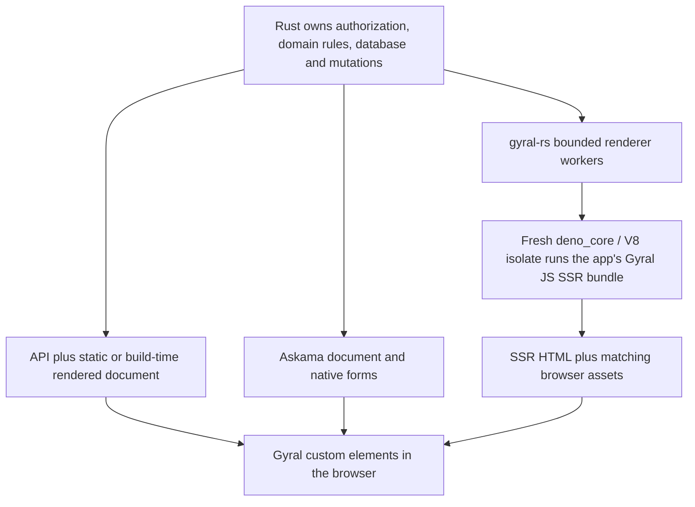

# Gymtime and gyral-rs in the ecosystem

The [consumer evidence](consumers.md) pins the reviewed source and verification reports.
Gymtime and gyral-rs demonstrate complementary integration paths. Gymtime's Cargo
manifests/lockfile do not establish a gyral-rs dependency; do not describe it as already
using the embedded renderer.

## Three application paths

**Gymtime today:** Rust domain/application/infrastructure/API/server crates and SQLite
own auth, roles, schedules, conflicts, approvals and writes. Thirteen Gyral components
implement the browser UI; the public landing page is rendered at build time. A shared
Effect `ManagedRuntime` sits behind drivers, carrying `AbortSignal` into
`runPromise`. Gyral owns individual commands; the document owns shared runtime disposal.
Its bfcache/pagehide policy is separate from removing a component.

This supports a substantial scheduling app without moving auth or transaction logic
into the UI framework. Latest reads, `exhaust` writes, queued preferences, revision
guards and idempotency keys remain application decisions. A canceled browser command
cannot roll back a Rust transaction that already committed.

**Askama plus client Gyral:** Rust renders the document and native forms; Gyral first-renders
selected client widgets. gyral-rs's notes example keeps Rust authorization, CSRF,
SQLite, validation, redirects and rejected drafts working without JavaScript. A Gyral
preview observes native controls. This path needs no server JavaScript engine.

**Embedded SSR:** gyral-rs is an adapter executing the actual Gyral JavaScript SSR bundle
inside Rust through deno_core/V8. It is not a Rust rewrite of Gyral's DOM renderer.
The server has no Node runtime dependency; Node remains a build tool. Rust loads
authorized DTOs, invokes a reviewed rendering bundle and maps its result into HTTP.
Matching Gyral browser assets then hydrate the component HTML.

## Supported contract and current limits

| Boundary                  | Inspected contract                                                                                                 |
| ------------------------- | ------------------------------------------------------------------------------------------------------------------ |
| Distribution              | Three 0.1.0 Rust crates, `publish = false`, Cargo path dependencies; not on crates.io                              |
| JavaScript packages       | Exact npm core/SSR 0.3.1, registry integrity and matching server/client build manifests                            |
| Supported embedded target | Linux x86_64 GNU, Rust 1.99.0/edition 2024, deno_core 0.412.0, V8 150.4.0                                          |
| ABI                       | Version 1, `gyralBundleVersion = 1`, `gyralRender({ page, props })` returns HTML string or Promise                 |
| Resource bounds           | Props 256 KiB, HTML 2 MiB, bundle 8 MiB; bounded workers, deadlines, cancellation, heap limits and shutdown        |
| JavaScript environment    | No browser DOM, filesystem, network or general Node API; minimal TextEncoder/ICU support                           |
| Browser bundle            | One self-contained IIFE entry; split browser chunks/dynamic CSS/streaming are not established compatibility claims |
| Trust                     | Reviewed app bundles only; resource limits do not establish an untrusted-code sandbox                              |
| CSP/assets                | Digest/SRI and matching build policy; app retains routing, response headers, permissions and approved data         |

The consumer reports stable `make ci`: 64 Rust tests, four doctests, three snapshot
checks, operating/OTLP probes, Chromium/WebKit SSR/client/notes suites, package inventory
and container smoke checks. These were not rerun in this audit. Its updated release
evidence explicitly makes no hosted-CI or external-publication claim.

## Snapshot experiment: useful evidence with a narrow conclusion

The current default uses a fresh isolate and evaluates the bundle per request.
An experimental snapshot prepares the rendering bundle, then restores a fresh isolate
per render. It must never snapshot request DTOs or share mutable request globals.
Recorded checks cover module/global/microtask isolation and resource/lifecycle limits.

The stable fixture comparison used eighteen isolated release processes and 6,161
successful concurrent-window renders. For one worker/one active client, median
run-level throughput was 23.72 versus 47.49 renders/second, and p95 was 60.58 versus
35.06 ms. Median sampled peak process RSS was 38.21 versus 39.76 MiB. There were three
runs per candidate and worker count on a shared host. These observations do not predict
Gymtime latency, complete-app compatibility or performance versus another framework.

The snapshot remains test-only. Complete-application artifacts and lifecycle validation
belong to the Rust repository's `gyral-rs-xun.5`. The Gyral coordination task is
`gyral-49t.15`; duplicating the Rust implementation issue here would obscure ownership.

## Implications for Gyral

Gyral should publish a rendering-path guide and exact cross-release compatibility
fixtures: npm versions, ABI, component HTML/hydration, serialized props, CSS/CSP,
manifest integrity and error/cancellation behavior. Rust crate packaging and supported
targets need their own roadmap before presenting embedded SSR as broadly available.

Gymtime should first adopt stable registry packages and verify booking, auth, forms,
race handling and cleanup. Its current build-time/client path is adequate evidence for
that integration; embedded runtime SSR should be evaluated only against an actual
initial-HTML, deployment or performance requirement. A shared booking/auth example
can teach drivers and ownership while keeping backend domain policy outside core.
